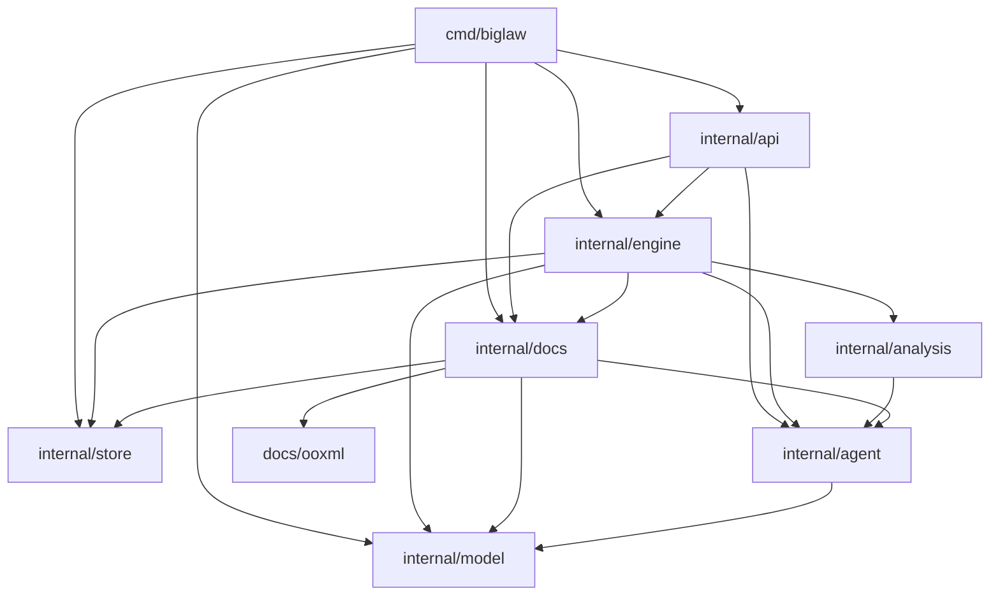
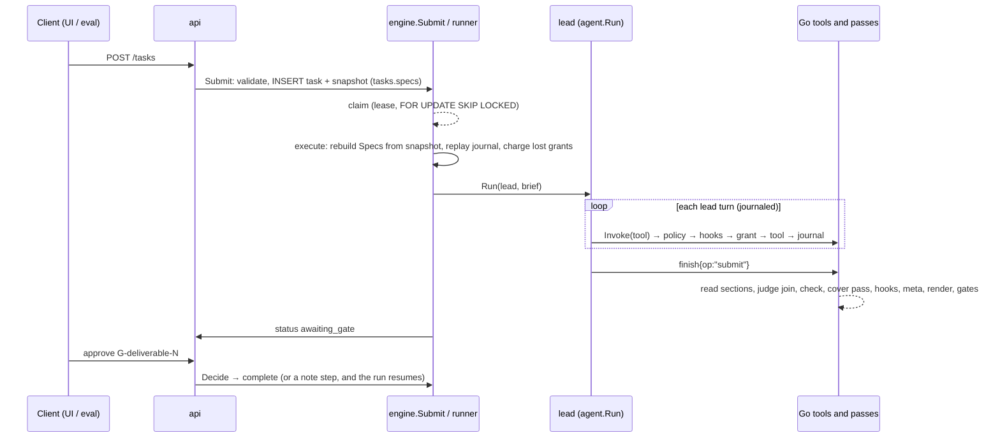
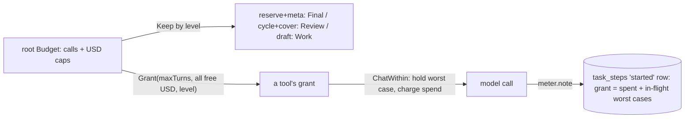
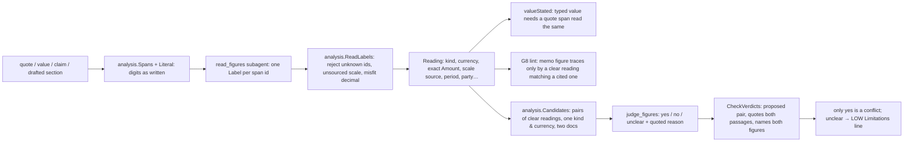

# BigLaw 2 architecture

This page describes the system in one place: the packages and the rules between them, what
happens to a task from submission to the rendered memo, and the mechanisms that cut across that
path (budget and journal, the spec set, the figure pipeline, hooks, custom tools). It is a map.
The README is still the contract for behaviour and bounds, and each section below links to the
code that implements it. [patterns.md](patterns.md) explains *why* the code is shaped this way,
and [glossary.md](glossary.md) defines the vocabulary.

Every statement here was checked against the code at `v2` 29def72. If a statement and the code
disagree, the code is right. Fix this page in the same change.

## 1. Packages and boundaries

One Go module, one binary, one PostgreSQL database. Eight production packages live under
`internal/`, plus two test-support packages and the command:

| Package | Owns | Lines (prod, approx.) |
|---|---|---:|
| [`cmd/biglaw`](../cmd/biglaw) | `serve` and `version`, the env-var table (`config.go`), the vendor breakers, the startup wiring, the `bad_host` guard, graceful stop | 680 |
| [`internal/store`](../internal/store) | `Open` (DSN check, pgvector, migrations), `InTx`, chunked `bytea` files with SHA-256, the migration runner, name and id policy | 660 |
| [`internal/model`](../internal/model) | The only code that talks to a model: the OpenAI-compatible chat and embeddings client, typed errors and their HTTP mapping, `Roles`, the price table, `model.Fake` | 1,000 |
| [`internal/docs`](../internal/docs) (+ [`ooxml`](../internal/docs/ooxml)) | Documents, sections and chunks: ingest (PDF and `.docx` in a bounded child process), vision transcription, the section tree, lexical and hybrid search, the page reader, the verification ladder, the document routes, and the `retrieve` and `verify_quote` tools | 3,250 |
| [`internal/agent`](../internal/agent) | The runtime: `Tool`/`Spec`/`Call`/`Result`, the registry, the schema subset, the one loop (`Runtime.Run`), the one dispatch path (`Runtime.Invoke`), `Budget`, the meter, `Journal`/`Step`, the bandit | 1,700 |
| [`internal/analysis`](../internal/analysis) | Pure functions over findings: figure spans (`figures.go`), label checking (`figread.go`), the cross-document join (`join.go`), exact calculation and handles (`numbers.go`), normalisers, coverage, BELO-lite, locators, and the `numbers` and `join_discrepancies` tools | 2,600 |
| [`internal/engine`](../internal/engine) | The memo workflow: the lead, the ledger, admission, sweep, figure reader and judge, deviation checks, drafting, committee, coverage pass, finish (lint, render, gates), durable runs, Manage (spec set, overrides, validation, diff and export), skills, packs, configurable hooks, custom tools | 14,500 |
| [`internal/api`](../internal/api) | The REST surface over the engine and docs, SSE, the Manage routes, the `Principal` seam, the embedded UI | 500 |
| [`internal/store/storetest`](../internal/store/storetest), [`internal/engine/figtest`](../internal/engine/figtest) | Test support: a schema per DB test, and the figure reader's stand-in | 650 |

The line counts are rounded from `wc -l`. `scripts/loc.py` prints the exact budget figures, and
the README's Budgets table is the place for those.

### The import rules the tests enforce

`TestImportBoundaries` ([`internal/agent/boundaries_test.go`](../internal/agent/boundaries_test.go))
runs `go list` and fails on any internal import that is not in its table. A new package must add
a row. The edges as built (the table also allows a few that no code uses yet, such as
`engine → docs/ooxml` and `api → analysis`):

The table also has rows for planned packages (`internal/contracts`, `internal/billing`,
`internal/clients`) that do not exist yet. The same test scans every production file outside
`internal/docs` and `internal/store` for SQL on `documents`, `chunks`, `sections` or `files`, and
for calls to `GetFile`/`PutFile`/`ReadFile`. Those tables are read only through `docs`, which
always takes a scope (G1).

Other structural guards:
- `agent` imports only `model`. `analysis` imports only `agent`, so it never touches the database
  or a model directly: the engine supplies its findings through the `analysis.Source` interface and
  the judge through `analysis.Judge`.
- Only `model` sends HTTP to a model. `docs` (embeddings, vision) and `agent` (chat) call it.
- `TestToolSchemasContainNoMatterData`: a definition is frozen at registration, so no matter data
  reaches a schema.
- `scripts/loc.py` (run by `make ci`) fails on a file over 2,000 lines, more than 12 internal
  packages, more than 3 direct dependencies, more than 20 env vars, a package without a
  `_test.go`, or a dynamic `os.Getenv`.

### The UI and eval

- [`ui/`](../ui) is React 19 and Vite, with no runtime dependencies besides `react` and
  `react-dom`. Every screen talks through one interface,
  [`ui/src/api/transport.ts`](../ui/src/api/transport.ts). `http.ts` implements it over the REST API.
  `recorded.ts` replays [`ui/src/recorded/recording.json`](../ui/src/recorded) in the browser with
  no network code at all (`test/offline.test.ts` builds the bundle and checks this). The
  recording is made by Go tests ([`eval/demo`](../eval/demo)) from v2's own `internal/docs`.
- [`eval/`](../eval) holds the five synthetic proof-run matters (`tasks/`), the Python scorer and
  driver (`run.py`, `proofrun/`), the Harvey LAB driver (`lab/`), the E4 embeddings tape, and the Go
  gates E1 (`TestProofRunsOracle`) and E2 (`TestProofRunsFabricator`), which run the real engine and
  API on a scripted model.

## 2. The lifecycle of a task

### Submit and snapshot
`POST /tasks` ([`internal/api/api.go`](../internal/api/api.go)) validates the body with the
agent's schema subset. It then calls `Engine.Submit`
([`internal/engine/runner.go`](../internal/engine/runner.go)), which refuses any workflow but
`memo`, checks that every document exists, and stores the task. The same `INSERT` stores
`snapshotSQL`: each Manage item's latest override (unless that override is the built-in again) goes
into `tasks.specs`. A later save reaches only the next task (§ 4).

### Claim, lease and execute
`Engine.Start` claims runnable tasks: queued tasks, or running ones whose lease is stale. It uses
`FOR UPDATE SKIP LOCKED`, takes a 30 s lease renewed every 10 s, and runs at most 4 at once
(`leaseFor`, `beat`, `maxRuns`). `drive` runs `execute` ([`run.go`](../internal/engine/run.go)),
which, on every claim:
1. rebuilds the run's `Specs` from `tasks.specs` (`newSpecs`) and puts it on the context
   (`withSpecs`);
2. pauses again if a hook gate is still undecided;
3. reads `task_steps`: committed, refused and failed steps become the replay. A `started` step
   (one in flight when a process died) is charged at its recorded grant into `tasks.lost` and
   deleted, so it is issued again;
4. builds the root `Budget` from the config and charges what the journal says was spent;
5. applies the phase keeps (`run.keep`, § 3);
6. builds the registry and runtime from the spec set (`Engine.runtime`,
   [`register.go`](../internal/engine/register.go)), and the lead's brief (`brief`: the request,
   the documents, the packs and the skill index);
7. runs the lead. The lead's tools are `leadVisible(sp)`: the 12 `MemoVisible` tools, then any
   admin subagent Go does not call itself, then enabled custom tools offered to the lead.

### The lead loop
`Runtime.Run` ([`internal/agent/loop.go`](../internal/agent/loop.go)) is the single loop for the
lead (depth 0) and every subagent (depth 1). Each turn is one model call through `ChatWithin`. Each
tool call goes through `Runtime.Invoke`, in this order:

1. it must be offered to that agent;
2. no subagent or fan-out may run at depth 1;
3. a call that must stand alone (`finish`, `ledger{op:"plan"}`) must be alone in its turn;
4. its input must match the input schema;
5. the task `Policy` must allow it ([`policy.go`](../internal/engine/policy.go): P1 plan first, P4
   class shares, the committee cycle cap);
6. the configurable hooks' `Before` must allow it;
7. a grant is taken from the budget;
8. the tool runs, its usage is charged, and its output is checked against the output schema;
9. the hooks' `After` runs;
10. the bandit records the result, and a lead step is journaled.

A tool result is shown to the model under a line saying that quoted document text is untrusted
data. Results older than four turns are compacted to a handle. A result over 100 KB is replaced
by the typed `result_too_large` refusal, never cut.

The memo lead's 12 tools are `retrieve`, `ledger`, `sweep`, `extract_facts`, `analyze_issue`,
`check_deviation`, `numbers`, `join_discrepancies`, `draft_section`, `committee`, `finish` and
`use_skill`. The lead prompt ([`specs/lead.md`](../internal/engine/specs/lead.md)) suggests an
order. Go enforces only P1 (only `retrieve`, `ledger`, `use_skill` and `finish` before a plan),
the class shares and the finish preconditions.

### Plan
`ledger{op:"plan"}` records the issues, the spine of the deliverable. Each issue is typed by a
BELO-lite issue class (Conduct, Requirement, Clause or RedFlag: `analysis/belo.json`). If the lead
spends its plan share (7%, at least 3 calls) without a plan, `fallbackPlan` records the packs'
checklist as the plan and says so in Limitations.

### Sweep
`sweep` ([`sweep.go`](../internal/engine/sweep.go), [`sweeporder.go`](../internal/engine/sweeporder.go))
is a Go fan-out that runs as one journaled lead step. It plans visits: every 600-token page of
every top-level section, with short sections batched together (`plan`, `sweepTokens`). It orders
them by BM25 of each issue's question, taken in turn across issues (`order`). It skips exact
duplicates and boilerplate (`skipWhy`). It runs up to 4 visits at once (`sweepWorkers`), each a
single `extract_facts` call on its page with no tools (`Call.NoTools`). Grants are fixed
regardless of timing, and admission happens in reading order (`awaitTurn`). Coverage per document
goes into the ledger (`swept`). Each visit's record (`visit`) holds the issues it was read for, so
a page is read again only for issues the plan gained since then (`issuesKey`). What the sweep's
share could not reach is reported and disclosed.

### Extract and admit
Four subagents are wrapped by Go (`hooked` in [`register.go`](../internal/engine/register.go)).
Go completes their requests: section text, the plan's issues, packs, the requirement's context, or
the drafter's whole request. Go then checks their answers before anything is recorded. There are **two admission paths**, and
a change to admission (G2/G3/G4, value admission, duplicates) must cover both.

**`Engine.admit`** ([`register.go`](../internal/engine/register.go)) serves `extract_facts` and
`analyze_issue`. It:
- puts every quote through the ladder (`verify`: `docs.VerifyQuote` exact and tolerant, then the
  `verify_quote` tool's paraphrase judge while the grant has calls). A finding is `Verified` only
  when every quote verifies (G2). Otherwise it is stored quarantined and never drafted from (G3),
  and G4 counts it;
- has the figure reader read the findings' numbers (§ 5) and keeps a typed value only when its own
  quote states it as read (`valueStated`). A dropped value becomes a `ValueNotes` entry, never a
  silent drop;
- merges only exact duplicates (`restated`);
- records each new finding through the one path, `recordFinding`, which runs `finding_admitted`
  hooks first (`TestFindingWritesGoThroughRecord`).

**`Engine.deviations`** ([`deviation.go`](../internal/engine/deviation.go)) serves
`check_deviation`. Before the subagent runs, `hooked.Call`:
1. verifies the requirement verbatim in the controlling document (`quotedRequirement`,
   `placeRequirement` in [`requirement.go`](../internal/engine/requirement.go));
2. reads the requirement in a bounded window of text around it (`contextOf`, about 3 KB each
   side, at most 8 KB);
3. hands the subagent the reviewed documents' nearest passages (`reviewedPassages`);
4. makes one critic call (`checkSection`) asking whether the document imposes the requirement as
   quoted. "no" fails the call.

After the subagent answers, `deviations` turns each verdict into a finding. It differs from
`admit`:
- a verdict whose controlling quote is not in the window (`within`; a quote that restates the
  requirement stands on the requirement, `restates`), whose quotes do not verify through the
  ladder, or (an omission) whose provision is present in the reviewed document (`present`) is
  **dropped with a note**. It is not stored quarantined, so G4 never counts it;
- a finding it keeps is stored `Verified`. It quotes the window verbatim, with the analyst's part
  and correction labelled as not quotations, and a correction stating a figure the quotes do not
  (`Untraced`) is withheld;
- it reads no figures and runs no `valueStated` or `restated` merge;
- "unclear", a truncated window or a missing check admits the finding at low confidence
  (`Finding.Low`, gated);
- it records through `recordFinding`, as `admit` does.

### Analyse
`analyze_issue` returns a rule, an application and a conclusion. Go keeps them for the issue's
drafter (ledger `analysis`) and notes authorities not in the record. The coverage pass treats a
Conduct or Requirement issue as analysed only when it has one (`needsLaw`, `touched` in
[`cover.go`](../internal/engine/cover.go)).

### Draft
`draft_section` gets its whole request from Go (`draftRequest`,
[`render.go`](../internal/engine/render.go)):
- the issue and the usable findings the call names (`fids`), with their quotes, each naming its
  document;
- a `{Codename}` handle per figure (`analysis.Handles`, kept for the run in ledger `handle`);
- a `{W…}` handle per `numbers` worksheet;
- the summaries of sections already written;
- on a redraft, the lint lines the current version fails;
- the latest analysis.

`saveSection` has the figure reader read the drafter's own figures (`readSection`), then stores
the section with its reading and the handle set the drafter got.

### Committee
`committee` ([`committee.go`](../internal/engine/committee.go)) runs three context-free critics in
parallel, each on an explicit grant (8/8/4 calls of a 20-call cycle):
- `prosecute` checks claims against their quotes;
- `reproduce` answers the issue questions from the documents, and Go compares the answers with
  the draft;
- `audit_gaps` reads the plan and the drafted headings (not the text) against the packs'
  checklist.

Their findings are HIGH, MEDIUM or LOW and stay open until the lead resolves them with `ledger
{op:"resolve"}`. A prosecute verdict credits or debits the bandit arm that produced the finding.
The lead may run at most three cycles (`maxCycles`).

### Cover
The coverage pass ([`cover.go`](../internal/engine/cover.go)) runs once per run, inside a passing
`submit`, or as its own step before a forced finish. For each touched issue it runs
`analyze_issue` and a redraft. It then places salient verified findings that no section cites, and
figure conflicts the memo does not state, with one redraft per issue (`placements`, `placeShare`).
After that the committee reviews the changed draft. Whatever the pass could not reach goes into
Limitations.

### Finish
`finish` ([`finish.go`](../internal/engine/finish.go)) takes `op:"check"` (a dry run) or
`op:"submit"`. In order:
1. read every stale section (`readSections`), from the grant first;
2. read unread claims that state figures, and judge the join's pending pairs, from a quarter of
   what is left (`judgeGrant`);
3. `check`: G8 lint for each section (`lintLimited`, [`lint.go`](../internal/engine/lint.go),
   [`lintground.go`](../internal/engine/lintground.go)), unstated conflicts, coverage
   (`analysis.CheckCoverage`), P6 (a committee on the current version; HIGH and MEDIUM findings
   resolved while the run can fund a fix) and the plan criteria. This step also collects every
   Limitations line;
4. on `submit`: the coverage pass if it is due, P7 escalation, the `task_finish` hooks, the meta
   note (one reserved call), `render`, and then `gates`.

After two finish calls that reported lint, a later call discloses the lint instead of refusing
(`maxLintRounds`). When the budget or step cap stops the lead, `execute` runs the coverage pass
and one last committee if the draft changed, then forces `finish{op:"submit"}` from the reserve.
That finish discloses what it could not fix.

### Render
`render` ([`render.go`](../internal/engine/render.go)) assembles the memo:
- sections in plan order, with handles substituted outside quotations;
- `polishSection` and `dedupeDocBlocks` ([`quality.go`](../internal/engine/quality.go));
- sentences citing an unusable finding dropped (`dropUnusable`);
- external authorities flagged (G5, [`authorities.go`](../internal/engine/authorities.go));
- Sources, with transcript citations badged (G11);
- Limitations, then the Computed figures block ([`computed.go`](../internal/engine/computed.go)),
  then the Evidence Note and the note to the reviewing lawyer.

All text from documents or models passes through `mdSafe`. The memo is stored as ledger note
`deliverable`, and copied to `tasks.output` by `finished`.

### Gates
`finish.gates` opens a finding gate (`G-<fid>`) for each cited finding that is `Low`, rests only
on low-confidence transcript pages, or has an open HIGH prosecute finding against it. Once those
are decided, it opens the deliverable gate (`G-deliverable-N`). The run stops `awaiting_gate`.
`Engine.Decide` ([`views.go`](../internal/engine/views.go)) records each decision:
- approving the deliverable completes the task;
- rejecting it adds a `note` step and resumes the lead;
- decided finding gates resume the run;
- decided hook gates (§ 6) resume the lead too; an approved call goes through once, when the
  lead makes it again with exactly the same input.

## 3. Budget, meter and journal

- **`agent.Budget`** ([`budget.go`](../internal/agent/budget.go)) is a tree. A grant holds calls
  and USD in its parent until it closes. A charge is spent at every level up. Closing returns the
  unused part. Levels (`LevelEvidence < LevelWork < LevelReview < LevelFinal`) come from the tool's
  class (`Level`). The root `Keep`s back, per level, what later phases need, and a grant never
  takes what a higher level keeps. So evidence cannot spend the drafting share, and only `finish`
  (`Final`) spends the reserve.
- **`ChatWithin`** ([`loop.go`](../internal/agent/loop.go)) holds one call and its worst-case cost
  (`bound`: every request byte a token, plus 1,000, billed as a cache write, plus `MaxTokens` of
  output). It then charges the real usage, including a billed refusal (`model.Error.Usage`). Go
  tools that call a model (`verify_quote`'s judge, `checkSection`) use it too.
- **Shares** ([`policy.go`](../internal/engine/policy.go) `Allocate`), in calls and USD:

  | Share | Calls | USD |
  |---|---|---|
  | plan | 7% (at least 3) | |
  | evidence | 45% | |
  | ↳ sweep | 24% | 20% |
  | ↳ the sweep's figure reader | 6% | 10% |
  | ↳ coverage pass, kept | 10% | |
  | draft | 15% | |
  | committee cycle | 20 calls, or 20% of a small budget | a fifth of the USD until a cycle has run, then 1.5 × the costliest cycle (`cycleKeep`) |
  | reserve | 5 | |
  | meta | 3 | |

  The policy refuses a lead call whose class share is spent (`classSpend` reads `task_steps`).
  Other fractions live beside the code that uses them: `judgeShare` (25%) in
  [`judge.go`](../internal/engine/judge.go), `placeShare` (40%) in `cover.go`, the critics'
  2/5, 2/5, 1/5 split in `Allocate`, a sweep visit's quarter of the sweep's USD in `sweep.go`, and
  `readerReserve` in [`figures.go`](../internal/engine/figures.go).
- **Journal** ([`steps.go`](../internal/engine/steps.go) `run.Record`). Every lead turn and lead
  tool call is a step. It is inserted `started` with its grant, then committed, refused or failed
  in one transaction with the ledger rows and bandit statistics the step buffered (`e.write`
  appends to `run.buf`; `e.rows` reads the buffer too). Every write checks the lease. Recording a step past
  `maxSteps` returns `errMaxSteps`, which ends the lead's run and forces the finish; recording the
  next step after a hook gate opened returns `errHeld`, which pauses the run.
- **Meter**. A journaled tool step carries a `meter` on its context. Every model call inside it
  (subagent turns, judges, sweep visits, critics) records the step again before it is sent, with
  the spend so far plus the in-flight worst cases, and again when it returns. `agent.Meter`
  records spend made without `ChatWithin`, such as a query embedding in `retrieve`
  (`docs.SearchMetered`).
- **Crash-resume** (G10). After a hard crash, resume charges a `started` step's last recorded
  grant: what its calls spent plus the worst case of those still in flight. A graceful stop
  settles an in-flight tool step's grant to what it spent. Committed steps replay from their
  recorded outputs, and no model call is repeated. The tests are `TestResumeAfterKillMidRun`,
  `TestHardCrashChargesOnlyRecordedSpend` and `TestKillDuringCommitteeChargesMeteredSpend`.

## 4. The spec set, overrides and snapshot

Everything a run reads is a file built into the binary. [`specset.go`](../internal/engine/specset.go)
`builtin` collects the following, keyed by repo path:
- `internal/engine/specs/` (the lead and meta prompts, the subagent specs and prompts under
  `specs/agents/`, the pass and tool specs);
- `packs/` and `skills/`;
- `internal/analysis/specs` and `internal/docs/specs`.

An item is the unit an admin edits, and `itemOf` maps every path to one. Item kinds:

| Kind | Path |
|---|---|
| `agent.<name>` | `specs/agents/<name>.json` and `.md` |
| `prompt.<name>` | `specs/<name>.md` |
| `pass.<name>` | `sweep`, `committee`, `cover`, `finish`, `ledger` |
| `tool.<name>` | a tool spec, or a custom tool under `specs/tools/` |
| `server.<name>` | `specs/servers/` |
| `rule.<name>` | `specs/hooks/` |
| `pack.<group>.<code>` | `packs/` |
| `skill.<name>` | `skills/<name>/` |

Go hooks are shown as kind `hook` (view only).

- **Overrides** ([`manage.go`](../internal/engine/manage.go), migration `0008_overrides.sql`).
  `spec_versions` is append-only. Each save, revert or skill create/delete is a new version holding
  all of the item's files: `NULL` files mean the built-in again, and `{}` is a tombstone. The table
  is the history and the change log. Events that are not versions (a secret set, a Test call) go to
  `manage_events`. Saves are serial (`locked`: an advisory lock and one transaction) and name their
  `base` version (a stale one is a 409).
- **Validation** ([`manage_validate.go`](../internal/engine/manage_validate.go)). Each file is
  checked strictly (`validateSpec`, `validatePack`, `validateSkillFile`, `validateHookRule`,
  `validateCustomTool`, `validateServer`). Then the whole set is built as a task would build it:
  `newSpecs`, the runtime's own registration, the lead's list, hook references. Then `compatSpec`
  checks that no property the built-in schema has is removed or retyped, no enum changes, and
  Go-written schemas gain no property. A further rule: no subagent may name a lead-only tool. Every
  problem is returned at once (422 `problems[]`).
- **Snapshot**. `Submit` copies the overrides into `tasks.specs`. `execute` rebuilds `Specs` from
  that copy on every claim, resumes included. Run code reads specs only through `spec(ctx, …)`,
  `prompt(ctx, …)`, `packsFor(ctx, …)` and `r.sp()`, never a package global. Docs and analysis
  tools are re-registered with their override's spec (`respec`).
- **Review rule** (`reviewRule`). Any change to a pack's or skill's content resets its status to
  `candidate`, unless the save names a new reviewer. A deliverable that used candidate packs or
  skills says so in Limitations.
- **Export** ([`diff.go`](../internal/engine/diff.go)). Overrides download as a git patch or a zip
  at repo paths, so a tuned version can become the new built-in through a normal PR.

## 5. The figure pipeline

A number's meaning is read by a model and never decided by a word list in Go (owner decision,
lab-r4 r4). Go finds spans, checks labels mechanically, and compares readings.

- **Spans** ([`analysis/figures.go`](../internal/analysis/figures.go)): `Spans` finds numbers as
  written, digits of any script included. A span's `Readings` are what its form allows ("1,200"
  can read 1200 or 1.2). `Literal` adds dates. Locators ("Section 14.2") are masked
  (`MaskLocators`, [`locators.go`](../internal/analysis/locators.go)) and never sent
  (`quotePassage`).
- **`read_figures`** ([`specs/agents/read_figures.json`](../internal/engine/specs/agents/read_figures.json),
  [`figures.go`](../internal/engine/figures.go)) runs on the critic role, with its own tools
  `figure_context` and `exact_calc` ([`figtools.go`](../internal/engine/figtools.go)). It labels
  each span by id. Calls hold at most 60 spans and 32 KB, smallest items first. A failed batch is
  read again in halves once. Spend comes from the caller's grant: the sweep's reader reads all its
  visits' findings at the sweep's end from its own share (`readQueue`, `readFindings`); a lead's
  own admission holds back a call beforehand (`goTurns`, `readerReserve`). Failures are counted in
  ledger `figstats`.
- **`ReadLabels`** ([`analysis/figread.go`](../internal/analysis/figread.go)) turns labels into
  `Reading`s:
  - a label for an unknown span is rejected;
  - a scale counts only when its source words are in the span's own passage, adjacent
    (`statesScale`);
  - a unit counts only with the words right after the digits (`statesUnit`);
  - a decimal mark must fit the digits;
  - the amount is always the written digits shifted by a power of ten.

  Whatever cannot be checked is unclear. `SameFigure` compares two readings.
- **Admission** (`applyReading`, `valueStated`). A typed value needs a quote span read as the same
  kind, currency, amount and scale. An unclear match admits it as `Low` (gated). `Value.Fig` is the
  reading that `Canon`, the join, `Calc` and `Salience` use.
- **G8** ([`lint.go`](../internal/engine/lint.go) `g8`, `lintLimited`). Every figure a section
  states must trace:
  - a handle's value, by construction;
  - a drafter-written figure, only by a clear reading of the section matching a clear cited
    reading;
  - a date, literally;
  - a worksheet result, only through `tracedSheets`.

  Anything else is flagged (a lint line), or *limited*: disclosed, with its citing finding gated.
  Limited covers a never-read quote, a scale written out on one side only, and a unit whose words
  differ. Figures that trace only through a worksheet or a reader's label are listed in the
  Computed figures block ([`computed.go`](../internal/engine/computed.go)).
- **The judge join** ([`analysis/join.go`](../internal/analysis/join.go),
  [`engine/judge.go`](../internal/engine/judge.go)). `Candidates` proposes pairs, ranked by
  `rankPairs` and capped at the judge's budget (`CandidateLimit`). `judge_figures` answers yes, no
  or unclear with a reason. `CheckVerdicts` rejects, with a note, a verdict for a pair Go did not
  propose. It makes a verdict unclear when its answer is not yes, no or unclear, when a second verdict
  names the same pair, when its reason does not quote both passages (`quoted`), or when a yes does not
  name both figures (`namesValues`). Verdicts are
  kept in ledger `verdict`.
- **Caches** (`figure_reads`, migrations 0006 and 0007). Complete reader answers and yes/no
  verdicts are keyed by `Specs.agentHash` (the agent's spec, its prompt and its allowed tools'
  specs), the model, the matter and exactly what was sent. A row is deleted with its task or any of
  its documents.

## 6. Hooks

Two kinds:

- **Go hooks** ([`hooks.go`](../internal/engine/hooks.go)) are the engine code around some tools:
  `hooked` (`extract_facts`, `analyze_issue`, `check_deviation`, `draft_section`), `sheets`
  (`numbers`) and `aliasJoin` (`join_discrepancies`) in `register.go`. Manage shows them read-only,
  with their source cut by `go/parser` from embedded copies of `register.go`, `deviation.go` and
  `render.go`.
- **Configurable rules** ([`hookrules.go`](../internal/engine/hookrules.go), items `rule.<name>`).
  An admin writes JSON `{name, enabled, order, event, match, when, action, failure}`.
  - Events: `before_call` and `after_call` (through `Runtime.Hooks` around every `Invoke`, except
    `finish` and `verify_quote`: `unhooked`), `finding_admitted` (`recordFinding`) and
    `task_finish` (in `finish`, before render).
  - Actions: `block`, `approve`, `check`, `webhook` and `limitation`.
  - A `before_call` `approve` opens a hook gate keyed by the rule, the tool and a 128-bit hash of
    the call's canonical input (`approveID`). The run pauses (`run.hold` → `errHeld` →
    `awaiting_gate`) until `Decide`. Only the lead's own calls can be approved; other callers of that
    tool fail closed. A `finding_admitted` `approve` opens no hook gate: it marks the finding `Low`,
    so the finding's own G7 gate opens at finish.
  - `after_call` rules on the four hooked subagents run on the subagent's answer before Go records
    anything (`afterHooked`).
  - A `finding_admitted` block sets `Finding.HookBlocked`. That is never `Verified=false`, so G4
    does not count it.
  - A rule's failure policy (`closed`/`open`) applies only to a `ruleFailure`. Any other error
    fails the call.
  - Every outcome is a ledger `hookrun` row written with its step.

## 7. Custom tools, remote policy, and admin/exposure

- **Custom subagents** (`specs/agents/`) use the built-ins' format, are validated the same way and
  run through the same `Invoke`.
- **Custom tools** ([`custom.go`](../internal/engine/custom.go)): an MCP tool (`kind:"mcp"`,
  imported from a server under `specs/servers/`) or an HTTP tool (`kind:"http"`). Their output is
  `{source, untrusted: true, text, truncated, isError}`. An imported description is third-party
  text: it is cleaned and capped by `untrustedText`, quoted inside BigLaw's own sentences
  (`importedDescription`), and its tool stays disabled until an admin accepts it (`acceptRule`).
- **Remote policy** ([`remote.go`](../internal/engine/remote.go)). Every request goes through
  `remoteClient`:
  - https only, ports 443 and 8443;
  - `checkURL` at save, `dialCheck` on every connection (IANA special-purpose ranges refused);
  - one refusal text whatever the reason;
  - redirects to the same host only, no proxy;
  - 30 s per whole call, a 1 MB answer, 64 KB of headers.

  Secrets (migration 0009, origin-bound since 0010) are read only by `secretValue`, sent only to
  their origin (`secretRef`), and redacted from answers (`redact`) and from errors built from
  remote data (`scrub`). `RemotePolicy.Off` turns secrets and custom outbound calls off when the
  server runs without a real admin.
- **Admin and exposure**. `api.Principal` is the who-seam ([`internal/api/manage.go`](../internal/api/manage.go)).
  Every POST wears `docs.Guard`, which refuses cross-site writes with 403 `cross_origin`. Manage
  writes also wear `admin` (`TestManageWriteRoutes` lists every write route). `cmd/biglaw` refuses
  requests by DNS name with 403 `bad_host` and decides who is an admin from the serve flags. Sign-in
  (PR 8) is being built on a separate branch and will change this part; the README's Exposure
  section is the contract until then.

## 8. Storage at a glance

| Table | Written by | Shape |
|---|---|---|
| `files`, `file_chunks` | `store` | 1 MiB `bytea` chunks, size and SHA-256 |
| `documents`, `sections`, `chunks` | `docs` | Text, the byte-exact section tree, chunks with `tsvector`s and an optional `vector` |
| `tasks` | engine | The request, run status, lease, `lost`, `specs` snapshot, `output` |
| `task_steps` | `run.Record` | The journal: one row per lead step |
| `ledger` | `e.write` (buffered per step) | JSON rows by `(task, kind, key)`; the kinds are listed in [glossary.md](glossary.md#ledger-kinds) |
| `tool_stats` | the bandit, via the step buffer | Per signature, tool and model |
| `figure_reads` | the figure reader and judge | A cross-run cache, by content key |
| `spec_versions`, `manage_events` | Manage | Append-only history and the change log |
| `secrets` | Manage | Values bound to an origin |
